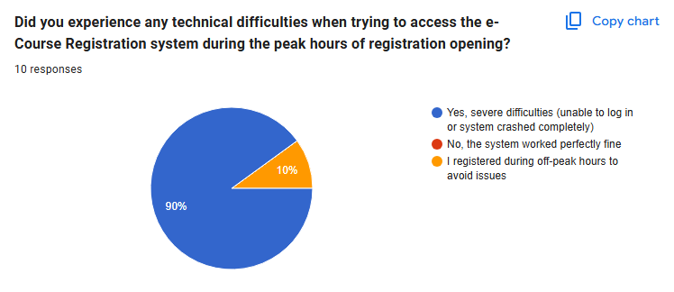
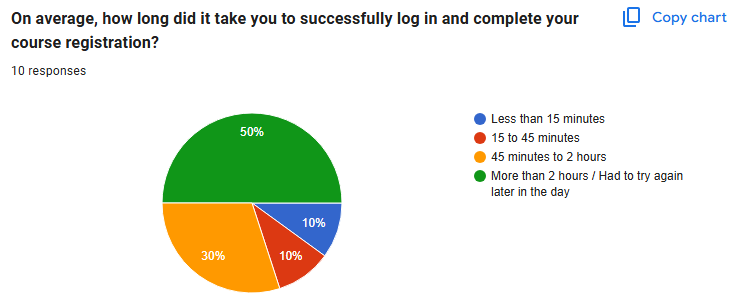

# Problem Statement

UiTM students must register for their courses online within a short announced window. Every semester, the e-course registration system becomes slow or inaccessible when many students log in at the same time, and students often cannot even open the registration page. Some students wait up to about three days before they can register successfully. This delays registration, risks losing seats in required courses, and forces students to keep retrying.

## Evidence

Based on my own experience across previous semesters, the UiTM e-course registration portal consistently becomes unresponsive or fails to load during the first few hours after registration opens.

To verify that this issue is common during registration period, a short survey was conducted via Google Forms involving 10 UiTM students. The results showed that 80% of respondents could not access the portal within the first hour of opening(full survey questions and charts are provided in Appendix A).

